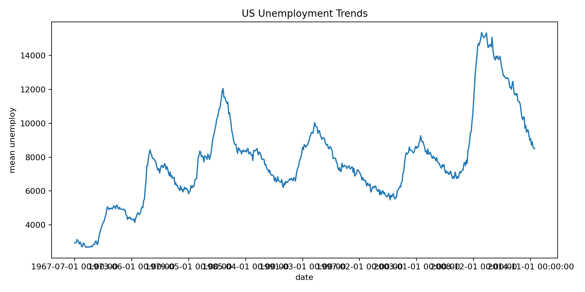

# US Unemployment Trends — executed results

## Decision question
How did the number unemployed change over the recorded period?

## Evidence
The first recorded mean is 2,944.000; the last is 8,526.000. The recorded period, rather than today, defines this comparison.

Raw rows: 574. Rows used: 574. Excluded for missing/nonfinite required values or invalid denominator: 0.

## Method
Complete-case descriptive comparison of unemploy by date; show group counts, mean, minimum and maximum.

## Interpretation and limitations
Unemploy is a count in thousands, not an unemployment rate; population changes matter. No causal inference, significance claim or production deployment is implied. Missing values are not imputed; identical rows are retained. Small or repeated samples limit uncertainty interpretation.

## Recommended next decision
Validate turning points against official labour statistics.

## Reproducibility
Source and exact downloaded-byte SHA256 are recorded in run_manifest.json. SQL results are in answer.csv and analysis.sqlite. Review quality_audit.csv before interpretation.
